# RIETI — Guía interna de desarrollo

> **Documento interno para el equipo.** Este README está escrito pensando en desarrolladores que pueden estar usando Git, GitHub, Android Studio, Node.js o un monorepo por primera vez. Si una instrucción parece demasiado básica, es intencional.

> Los diagramas de este documento están escritos con **Mermaid**, por lo que GitHub los renderiza como diagramas visuales directamente desde el Markdown.

---

## Índice

1. Qué es RIETI
2. Arquitectura general
3. Estructura del repositorio
4. Qué contiene cada carpeta
5. Reglas generales del proyecto
6. Programas necesarios
7. Git y GitHub desde cero
8. Configuración inicial de Git
9. Cómo obtener el proyecto por primera vez
10. Cómo abrir Android en Android Studio
11. Cómo inicializar Android por primera vez
12. Cómo inicializar la Web por primera vez
13. Cómo inicializar la API por primera vez
14. Base de datos
15. Variables de entorno y secretos
16. Flujo de trabajo diario con Git
17. Ramas
18. Commits
19. Push
20. Pull Requests
21. Cómo actualizar tu computadora después de un merge
22. Pull vs Push
23. Cambios locales y `git stash`
24. Conflictos de Git
25. Comandos más importantes
26. Convenciones de nombres
27. Reglas por componente
28. Seguridad
29. GitHub Actions
30. Infraestructura AWS
31. Cómo integrar una funcionalidad completa
32. Checklist antes de subir código
33. Errores comunes
34. Comandos rápidos
35. Regla de oro

---

# 1. Qué es RIETI

RIETI es una solución digital para la captura, canalización, seguimiento y análisis de reportes relacionados con posibles casos de trabajo infantil.

El sistema tiene tres componentes principales de producto:

- **Aplicación Android nativa** desarrollada en Kotlin.
- **Plataforma Web Administrativa** desarrollada con React + TypeScript.
- **Backend/API central** responsable de autenticación, permisos, reglas de negocio, persistencia y comunicación con servicios externos.

La base de datos prevista es **Amazon Aurora RDS compatible con MySQL 8.0**.

La infraestructura prevista utiliza principalmente:

```text
Amazon Aurora RDS
AWS Lambda
Amazon S3
```

Otros servicios de AWS pueden agregarse únicamente cuando exista una necesidad real.

---

# 2. Arquitectura general

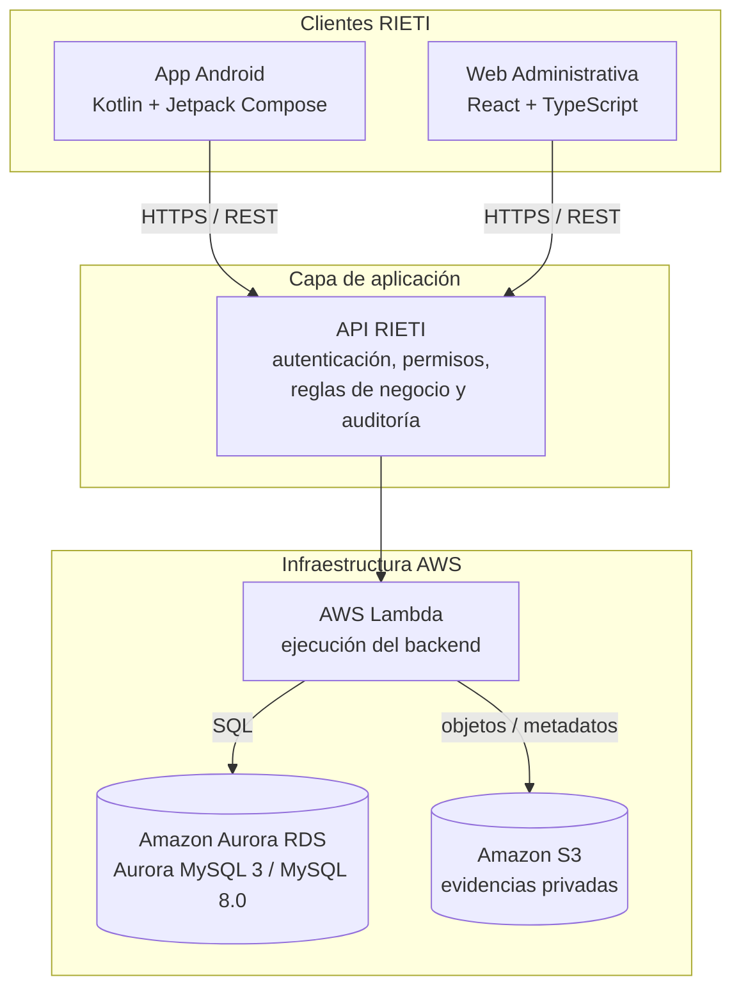

La Web y Android **nunca deben conectarse directamente a Aurora**.

Siempre:

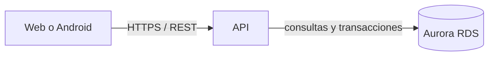

Las reglas de negocio y permisos deben ser validados por el backend, aunque la interfaz también tenga validaciones de experiencia de usuario.

---

# 3. Estructura del repositorio

RIETI utiliza **un único repositorio Git** organizado como monorepo.

```text
rieti/
│
├── apps/
│   ├── web/
│   │   └── .gitkeep
│   │
│   └── android/
│       └── .gitkeep
│
├── services/
│   └── api/
│       └── .gitkeep
│
├── contracts/
│   ├── openapi.yaml
│   └── schemas/
│       └── .gitkeep
│
├── database/
│   ├── migrations/
│   │   └── .gitkeep
│   ├── seeds/
│   │   └── .gitkeep
│   └── schema/
│       └── rieti_aurora_mysql.sql
│
├── infra/
│   └── aws/
│       └── README.md
│
├── docs/
│   ├── architecture/
│   │   └── .gitkeep
│   ├── security/
│   │   └── .gitkeep
│   └── diagrams/
│       └── .gitkeep
│
├── .github/
│   └── workflows/
│       └── .gitkeep
│
├── .gitignore
└── README.md
```

Los archivos `.gitkeep` existen únicamente porque Git no guarda carpetas vacías. Cuando una carpeta tenga archivos reales, el `.gitkeep` puede eliminarse.

---

# 4. Qué contiene cada carpeta

## `apps/android`

Código de la aplicación Android nativa.

Tecnologías:

```text
Kotlin
Jetpack Compose
Android Studio
Gradle Kotlin DSL
```

Ejemplos de funcionalidades:

- Login.
- Creación de reportes.
- Modalidad anónima o con seguimiento.
- GPS.
- Selección de ubicación.
- Evidencias fotográficas.
- Historial.
- Notificaciones.
- Manejo offline.
- Sincronización.

## `apps/web`

Código de la plataforma administrativa.

Tecnologías:

```text
React
TypeScript
```

Ejemplos:

- Login institucional.
- Listado y búsqueda de reportes.
- Expedientes.
- Estados y semáforo.
- Prioridades.
- Notas.
- Asignaciones.
- Usuarios y roles.
- Catálogos.
- Estadísticas.
- Mapas de calor.

## `services/api`

Código del backend.

Responsabilidades:

- autenticación;
- autorización;
- sesiones/JWT;
- usuarios;
- roles;
- municipios;
- reportes;
- estados;
- prioridades;
- notas;
- evidencias;
- S3;
- notificaciones;
- auditoría;
- exportaciones;
- acceso a Aurora;
- reglas de negocio.

Nunca confiar únicamente en una validación realizada por Web o Android.

## `contracts`

Contrato oficial entre Web/Android y la API.

El archivo principal es:

```text
contracts/openapi.yaml
```

Ejemplo de endpoints:

```text
POST   /auth/login
POST   /reports
GET    /reports
GET    /reports/{id}
PATCH  /reports/{id}/status
```

Cuando cambie la API, debe actualizarse también OpenAPI.

**No hacer cambios de API “de palabra” sin actualizar el contrato.**

## `contracts/schemas`

Esquemas reutilizables para contratos.

Ejemplos futuros:

```text
user.schema.json
report.schema.json
auth.schema.json
error.schema.json
```

## `database/schema`

Contiene el esquema completo de la base de datos.

Archivo inicial:

```text
database/schema/rieti_aurora_mysql.sql
```

## `database/migrations`

Cambios futuros de estructura.

Ejemplo:

```text
001_initial_schema.sql
002_add_report_source.sql
003_add_notifications_index.sql
```

No depender de cambios manuales realizados únicamente desde la consola de AWS.

## `database/seeds`

Datos iniciales y catálogos oficiales.

Ejemplos:

```text
municipios.sql
tipos_trabajo.sql
dependencias.sql
```

No inventar datos oficiales.

## `infra/aws`

Documentación/configuración relacionada con AWS.

Puede incluir posteriormente:

```text
Lambda
Aurora RDS
S3
IAM
API Gateway
VPC
Security Groups
Variables de entorno
```

Nunca guardar aquí secretos o claves privadas.

## `docs`

Documentación técnica interna.

```text
docs/architecture  → arquitectura y decisiones técnicas
docs/security      → seguridad, permisos y privacidad
docs/diagrams      → diagramas exportados
```

## `.github/workflows`

Automatizaciones de GitHub Actions.

Más adelante puede ejecutar automáticamente:

```text
tests
lint
build web
build API
build Android
```

---

# 5. Reglas generales del proyecto

## 5.1 No trabajar directamente sobre `main`

`main` representa el código integrado.

Mal:

```text
editar main → commit → push main
```

Bien:

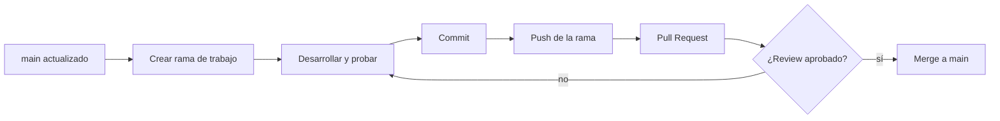

La única excepción razonable es la **inicialización acordada del repositorio**.

## 5.2 Hacer `pull` antes de iniciar una tarea nueva

```bash
git checkout main
git pull origin main
```

Luego crear la rama.

## 5.3 No subir secretos

Nunca subir:

```text
.env
passwords
tokens
AWS keys
JWT secrets
DB passwords
private keys
.pem privados
```

## 5.4 No subir archivos generados

Ejemplos:

```text
node_modules/
build/
.gradle/
.idea/
local.properties
dist/
```

Deben estar cubiertos por `.gitignore`.

## 5.5 Una funcionalidad debe respetar las capas

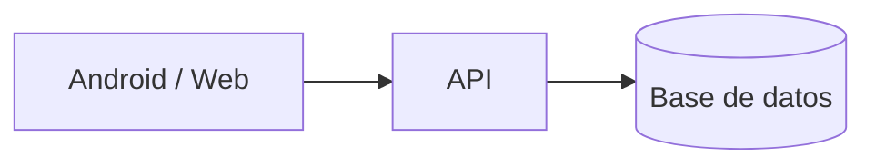

No solucionar permisos únicamente escondiendo botones.

---

# 6. Programas necesarios

Cada desarrollador necesita como mínimo:

## Git

Verificar:

```bash
git --version
```

## Cuenta de GitHub

Cada integrante necesita acceso al repositorio RIETI.

## Android Studio

Necesario para Android.

Incluye/utiliza:

- Android SDK.
- Gradle.
- JDK/JBR.
- Emulador Android.

## Node.js

Necesario para Web y API.

Instalar una versión **LTS**.

Verificar:

```bash
node --version
npm --version
```

## Editor recomendado para Web/API

```text
Visual Studio Code
```

---

# 7. Git y GitHub desde cero

Git y GitHub cumplen papeles distintos: Git lleva el historial local y GitHub permite compartir ese historial con el resto del equipo.

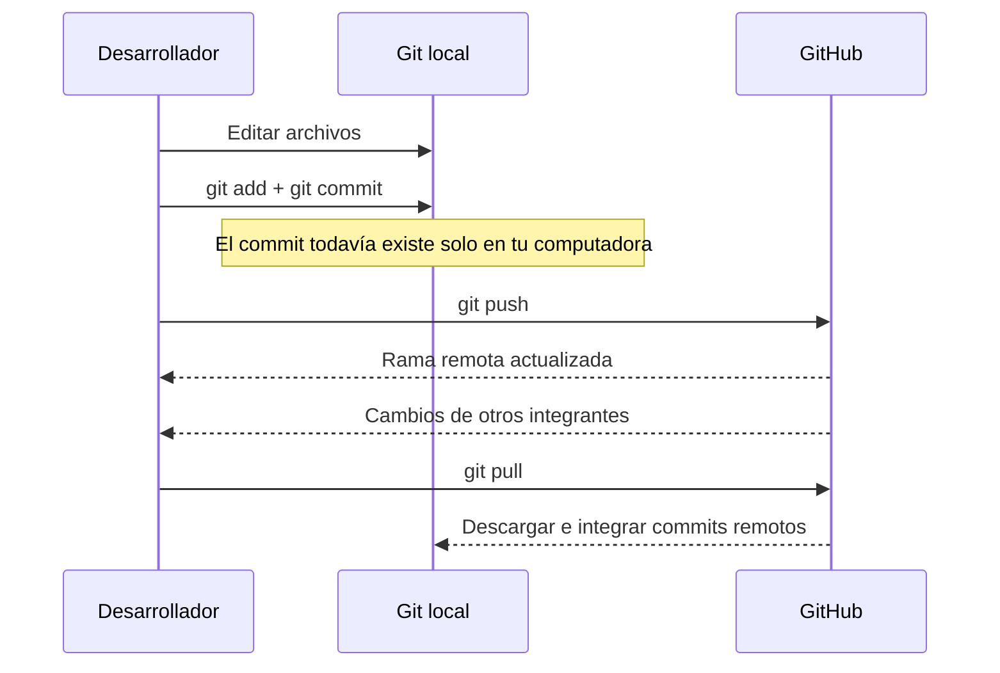

## Git

Git funciona **en tu computadora** y registra versiones del proyecto.

## GitHub

GitHub almacena el repositorio remoto y permite colaborar.

## Repositorio local

La copia en tu computadora.

Ejemplo:

```text
C:\Users\TU_USUARIO\Documents\rieti
```

## Repositorio remoto

La copia alojada en GitHub. Git normalmente la llama:

```text
origin
```

## Commit

Una “fotografía” de cambios guardada en la historia del proyecto.

## Branch / rama

Una línea independiente de desarrollo.

Ejemplos:

```text
main
feat/android-login
feat/api-auth
fix/web-report-filter
```

## Push

```text
tu computadora → GitHub
```

## Pull

```text
GitHub → tu computadora
```

## Pull Request

Solicitud para integrar una rama en otra, normalmente:

```text
feat/algo → main
```

---

# 8. Configuración inicial de Git

Se hace **una sola vez por computadora**.

```bash
git config --global user.name "Tu Nombre"
git config --global user.email "tu-correo@example.com"
```

Verificar:

```bash
git config --global --list
```

En Windows también puede utilizarse:

```bash
git config --global core.autocrlf true
```

---

# 9. Cómo obtener el proyecto por primera vez

## Importante

Si el repositorio ya existe en GitHub, **NO crees otro repositorio ni otro proyecto Git**.

Debes **clonarlo**.

```text
GitHub → Clone → trabajar
```

## Paso 1 — Copiar URL del repositorio

En GitHub:

```text
Code → HTTPS → copiar URL
```

Parecida a:

```text
https://github.com/ORGANIZACION/rieti.git
```

## Paso 2 — Elegir dónde guardar el proyecto

Ejemplo en PowerShell:

```powershell
cd C:\Users\TU_USUARIO\Documents
```

## Paso 3 — Clonar

```bash
git clone https://github.com/ORGANIZACION/rieti.git
```

## Paso 4 — Entrar

```bash
cd rieti
```

## Paso 5 — Verificar remoto

```bash
git remote -v
```

Debe aparecer `origin` para fetch y push.

## Paso 6 — Verificar estado

```bash
git status
```

Si aparece:

```text
On branch main
Your branch is up to date with 'origin/main'.
nothing to commit, working tree clean
```

está correcto.

---

# 10. Cómo abrir Android en Android Studio

RIETI es un monorepo. El proyecto Android está en:

```text
rieti/apps/android
```

En Android Studio:

```text
Open
→ seleccionar rieti/apps/android
→ Open
```

No es necesario abrir toda la raíz `rieti/` como proyecto Android, porque la raíz no será el proyecto Gradle.

Git seguirá detectando el repositorio padre.

También puedes usar la terminal integrada:

```text
View → Tool Windows → Terminal
```

---

# 11. Cómo inicializar Android por primera vez

> Esta sección la ejecuta **una sola persona una sola vez**. Después de que el proyecto Android se suba a GitHub, el resto solo lo clonará.

Antes de crear el proyecto, eliminar:

```text
apps/android/.gitkeep
```

Desde la raíz del repo en PowerShell:

```powershell
Remove-Item apps\android\.gitkeep
```

En Android Studio:

```text
New Project
→ Phone and large screens
→ Empty Activity
```

La plantilla `Empty Activity` utiliza Jetpack Compose.

## Configuración recomendada

### Name

```text
RIETI
```

### Package name

No dejar `com.example.rieti` como identificador definitivo.

El equipo debe acordar un package estable. Ejemplo técnico:

```text
com.rieti.app
```

### Save location — MUY IMPORTANTE

No guardar Android en la raíz:

```text
...\RIETI
```

Debe guardarse en:

```text
...\RIETI\apps\android
```

Ejemplo:

```text
C:\Users\TU_USUARIO\Documents\RIETI\apps\android
```

**En la captura actual de Android Studio la ubicación está en `...\RIETI`; antes de presionar `Finish`, cámbiala a `...\RIETI\apps\android`.**

### Minimum SDK

El documento del proyecto exige definir una versión mínima, pero no fija un número concreto.

Si el equipo acuerda:

```text
API 26 — Android 8.0 Oreo
```

puede mantenerse API 26.

### Build configuration language

```text
Kotlin DSL (build.gradle.kts)
```

Después de `Finish`, esperar:

```text
Gradle Sync
Indexing
Dependency download
```

Luego desde la raíz del repo:

```bash
git status
```

Revisar los archivos y subir la inicialización acordada.

---
# 12. Cómo inicializar la Web por primera vez

> Se ejecuta una sola vez para crear el proyecto React.

Desde la raíz del repo:

```powershell
Remove-Item apps\web\.gitkeep
```

Verificar Node y npm:

```bash
node --version
npm --version
```

Crear React + TypeScript con Vite:

```bash
npm create vite@latest apps/web -- --template react-ts
```

Entrar:

```bash
cd apps/web
```

Instalar dependencias:

```bash
npm install
```

Ejecutar localmente:

```bash
npm run dev
```

Vite mostrará una URL local, normalmente:

```text
http://localhost:5173
```

Volver a la raíz:

```bash
cd ../..
```

Revisar:

```bash
git status
```

---

# 13. Cómo inicializar la API por primera vez

> Se ejecuta una sola vez para crear el proyecto del backend.

Desde la raíz:

```powershell
Remove-Item services\api\.gitkeep
```

Entrar:

```bash
cd services/api
```

Inicializar Node:

```bash
npm init -y
```

Instalar Express:

```bash
npm install express
```

Dependencias que probablemente serán necesarias conforme avance el proyecto:

```text
mysql2
zod
jsonwebtoken
bcryptjs
cors
helmet
dotenv
```

No instalar librerías “por si acaso”. Agregar dependencias cuando exista una necesidad concreta.

El backend previsto debe poder desplegarse en AWS Lambda. La forma exacta de empaquetar Express/handlers para Lambda debe acordarse antes de implementar el despliegue.

Volver a raíz:

```bash
cd ../..
```

---

# 14. Base de datos

La base inicial se encuentra en:

```text
database/schema/rieti_aurora_mysql.sql
```

Está diseñada para:

```text
Amazon Aurora MySQL 3
compatible con MySQL 8.0
```

## Nunca conectar Android o React directamente a Aurora

Incorrecto:

```text
Android → Aurora
React   → Aurora
```

Correcto:

```text
Android → API → Aurora
React   → API → Aurora
```

## Migraciones

Una vez iniciado el desarrollo, cualquier cambio futuro del esquema debe quedar versionado.

Ejemplo:

```text
database/migrations/
001_initial_schema.sql
002_add_field_x.sql
003_add_index_y.sql
```

## Seeds

Datos iniciales y catálogos:

```text
database/seeds/
```

## Regla importante

No modificar producción manualmente y luego olvidar el cambio.

Si cambia la base:

```text
cambio SQL
→ migration
→ commit
→ PR
→ despliegue
```

---

# 15. Variables de entorno y secretos

Los secretos **NO se suben a GitHub**.

Ejemplo de variables futuras del backend:

```env
DB_HOST=
DB_PORT=3306
DB_NAME=rieti
DB_USER=
DB_PASSWORD=

JWT_SECRET=

AWS_REGION=
S3_BUCKET=
```

El archivo real puede llamarse:

```text
services/api/.env
```

y debe estar ignorado por Git.

Sí puede existir:

```text
services/api/.env.example
```

sin valores sensibles:

```env
DB_HOST=
DB_PORT=3306
DB_NAME=rieti
DB_USER=
DB_PASSWORD=
JWT_SECRET=
AWS_REGION=
S3_BUCKET=
```

En AWS Lambda, los secretos reales deben administrarse mediante configuración segura de AWS y no escribirse en el código fuente.

---

# 16. Flujo de trabajo diario con Git

Supongamos que vas a implementar el login Android.

## Paso 1 — Entrar al repositorio

```bash
cd ruta/al/rieti
```

## Paso 2 — Revisar que no tengas trabajo pendiente

```bash
git status
```

Ideal:

```text
nothing to commit, working tree clean
```

## Paso 3 — Ir a `main`

```bash
git checkout main
```

## Paso 4 — Descargar lo más reciente

```bash
git pull origin main
```

## Paso 5 — Crear tu rama

```bash
git checkout -b feat/android-login
```

## Paso 6 — Trabajar normalmente

Editar código y probarlo.

## Paso 7 — Revisar cambios

```bash
git status
git diff
```

## Paso 8 — Agregar cambios al commit

Archivos específicos:

```bash
git add apps/android
```

O todo:

```bash
git add .
```

Antes de `git add .`, revisar siempre `git status`.

## Paso 9 — Commit

```bash
git commit -m "feat(android): implement login screen"
```

## Paso 10 — Push

Primera vez que subes esa rama:

```bash
git push -u origin feat/android-login
```

Después, en la misma rama:

```bash
git push
```

## Paso 11 — Crear Pull Request

En GitHub:

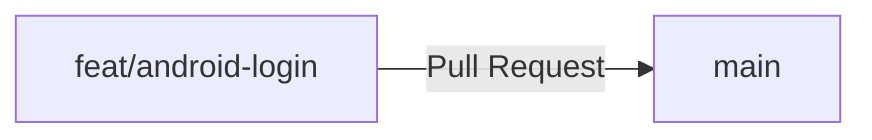

Otro integrante revisa y después se hace merge.

---

# 17. Ramas

## Rama principal

```text
main
```

No desarrollar funcionalidades directamente ahí.

## Nombres recomendados

Nueva funcionalidad:

```text
feat/android-login
feat/web-dashboard
feat/api-auth
feat/api-reports
```

Corrección:

```text
fix/android-gps-permission
fix/web-filter
fix/api-report-status
```

Documentación:

```text
docs/api-auth
docs/security-model
```

Infraestructura:

```text
infra/aws-lambda
infra/rds-security-group
```

Refactor:

```text
refactor/api-report-service
```

---

# 18. Commits

Un commit debe representar un cambio lógico.

Mal:

```text
cosas
cambios
ya quedo
fix
asdf
```

Bien:

```text
feat(android): add report modality selector
feat(api): create report endpoint
fix(web): correct municipality filter
docs: document local setup
test(api): add authentication tests
chore: update dependencies
```

Prefijos recomendados:

```text
feat      nueva funcionalidad
fix       corrección
docs      documentación
test      pruebas
refactor  reorganización sin cambiar comportamiento
chore     mantenimiento/configuración
infra     infraestructura
```

---

# 19. Push

`push` envía commits locales a GitHub.

```bash
git push
```

Si la rama aún no tiene upstream:

```bash
git push -u origin nombre-de-tu-rama
```

Ejemplo:

```bash
git push -u origin feat/api-auth
```

Para este equipo:

> **No utilizar `git push --force`.**

Si aparece un error que parece requerir `--force`, detenerse y pedir revisión.

---

# 20. Pull Requests

Un Pull Request permite revisar código antes de integrarlo.

Un PR debe explicar:

```text
Qué se hizo
Por qué
Qué componente cambia
Cómo se probó
Si afecta DB/API
```

Ejemplo:

```markdown
## Qué cambia

Implementa login en Android.

## API usada

POST /auth/login

## Pruebas

- Login correcto
- Contraseña incorrecta
- Usuario inactivo

## Pendiente

- Recuperación de contraseña
```

Antes de merge revisar:

- compila;
- no rompe funcionalidades existentes;
- no contiene secretos;
- está actualizado con `main`;
- OpenAPI se actualizó si cambió la API;
- hay migración si cambió DB;
- existen pruebas cuando corresponda.

---

# 21. Cómo actualizar tu computadora después de un merge

Si otra persona terminó una funcionalidad y su PR ya fue integrado:

```bash
git status
git checkout main
git pull origin main
```

Tu `main` local ya está actualizado.

Para una tarea nueva:

```bash
git checkout -b feat/nueva-tarea
```

Si tu antigua rama ya fue integrada:

```bash
git checkout main
git pull origin main
git branch -d feat/android-login
```

---

# 22. Pull vs Push


## Push

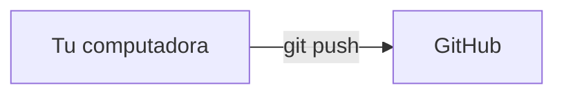

```bash
git push
```

## Pull

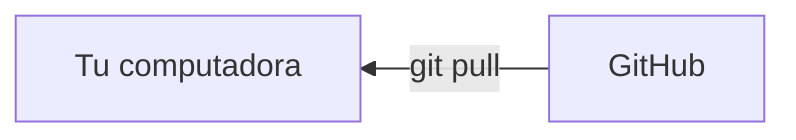

```bash
git pull
```

## Commit

Un commit no sube nada a Internet.

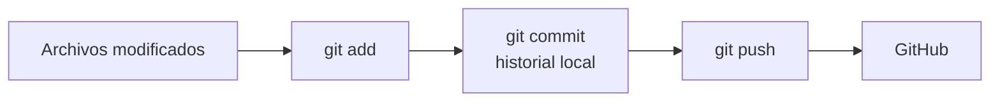

---

# 23. Cambios locales y `git stash`

Primero:

```bash
git status
```

Si tienes cambios modificados, no ejecutes comandos al azar para “quitar el error”.

## Opción A — Tus cambios sí sirven

```bash
git add .
git commit -m "wip: save current progress"
```

Evitar `wip` en la historia final cuando sea posible.

## Opción B — Todavía no quieres hacer commit

Guardar temporalmente:

```bash
git stash
```

Después puedes recuperar:

```bash
git stash pop
```

## Opción C — Los cambios no sirven

Un archivo:

```bash
git restore ruta/del/archivo
```

Todos los archivos modificados:

```bash
git restore .
```

**Esto elimina cambios no guardados.** Usar con cuidado.

---

# 24. Conflictos de Git

Un conflicto ocurre cuando Git no puede combinar automáticamente cambios de dos personas.

Puede verse así:

```text
<<<<<<< HEAD
código A
=======
código B
>>>>>>> otra-rama
```

Debes decidir qué código debe quedar, eliminar manualmente los marcadores y guardar.

Después:

```bash
git add archivo
git commit
```

Si no entiendes el conflicto:

> No borres archivos completos, no uses force push y no hagas reset aleatoriamente. Pide ayuda antes de continuar.

---
# 25. Comandos de Git más importantes

## Ver estado

```bash
git status
```

Probablemente será el comando que más utilices.

## Ver rama actual

```bash
git branch
```

La rama actual aparece con `*`.

## Cambiar de rama

```bash
git checkout nombre-rama
```

También existe:

```bash
git switch nombre-rama
```

## Crear rama

```bash
git checkout -b nombre-rama
```

O:

```bash
git switch -c nombre-rama
```

## Descargar cambios

```bash
git pull origin main
```

## Agregar cambios

```bash
git add .
```

O un archivo/carpeta específico:

```bash
git add ruta/archivo
```

## Commit

```bash
git commit -m "mensaje"
```

## Subir

```bash
git push
```

## Ver commits recientes

```bash
git log --oneline --decorate -10
```

## Ver cambios aún no agregados

```bash
git diff
```

## Ver cambios ya agregados al staging

```bash
git diff --staged
```

## Ver remotos

```bash
git remote -v
```

## Descargar información del remoto sin tocar archivos

```bash
git fetch origin
```

## Guardar temporalmente cambios

```bash
git stash
```

Recuperar:

```bash
git stash pop
```

---

# 26. Convenciones de nombres

## Código

Preferir inglés para nombres técnicos:

```text
ReportService
AuthMiddleware
MunicipalityRepository
ReportStatus
```

La interfaz visible para usuarios debe estar en español.

## Branches

Formato:

```text
tipo/componente-descripcion
```

Ejemplos:

```text
feat/android-report-form
fix/api-auth-validation
```

## Archivos

Evitar:

```text
prueba2.js
nuevo-final.kt
versionbuena.ts
cosas.js
```

Usar nombres descriptivos.

---

# 27. Reglas específicas por componente

## Android

- Kotlin.
- Jetpack Compose.
- No guardar claves en código.
- No llamar Aurora directamente.
- Manejar permisos GPS correctamente.
- Manejar errores de red.
- Preparar modo offline según requerimiento.
- No asumir que siempre existe Internet.

## Web

- React + TypeScript.
- Interfaz responsiva.
- Validar permisos por rol también en backend.
- No confiar en esconder botones como mecanismo de seguridad.
- Considerar accesibilidad desde el desarrollo.

## API

- Toda operación protegida debe validar identidad y permisos.
- Validar entradas.
- Nunca devolver stack traces sensibles al cliente.
- Nunca registrar passwords o tokens completos.
- Hash de contraseñas.
- Consultas parametrizadas.
- Transacciones para operaciones críticas.
- Auditoría para modificaciones sensibles.
- Paginación para listados grandes.

## Database

- No borrar expedientes arbitrariamente.
- Mantener trazabilidad.
- Migraciones versionadas.
- UTC en almacenamiento.
- Índices para consultas.
- Evidencias en S3 + referencia segura, no como archivos públicos.

---

# 28. Seguridad

Este proyecto maneja información sensible.

## Nunca

```text
subir contraseñas
subir JWT
subir credenciales AWS
subir .env
poner passwords en README
poner secretos en screenshots
loguear datos sensibles
```

## Credenciales de DB

Incorrecto:

```javascript
const password = "MiPassword123";
```

Correcto:

```javascript
const password = process.env.DB_PASSWORD;
```

## Contraseñas de usuarios

Nunca almacenar contraseña en texto plano. Guardar únicamente un hash robusto.

## Evidencias

Las evidencias deben almacenarse de forma privada y segura. No utilizar buckets públicos.

## Auditoría

Las operaciones sensibles deben poder rastrearse.

---

# 29. GitHub Actions

La carpeta:

```text
.github/workflows/
```

se utilizará posteriormente para CI.

Ejemplo futuro:

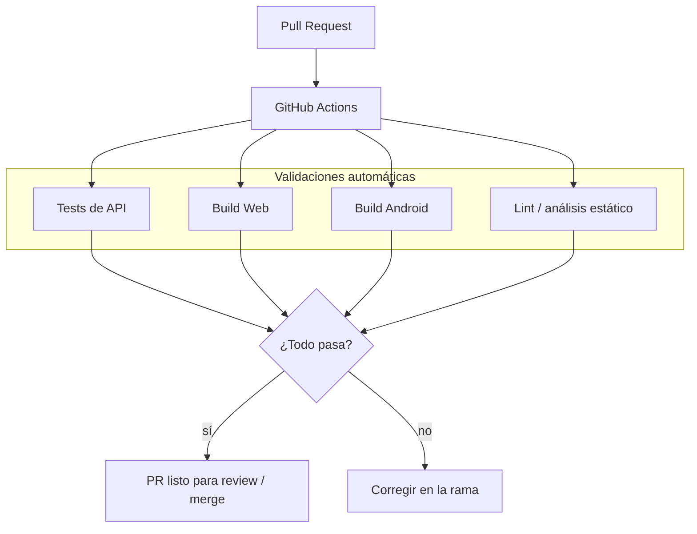

Archivos posibles:

```text
.github/workflows/api-ci.yml
.github/workflows/web-ci.yml
.github/workflows/android-ci.yml
```

No es obligatorio configurarlos el primer día.

---

# 30. Infraestructura AWS

La arquitectura objetivo en AWS se entiende mejor así:

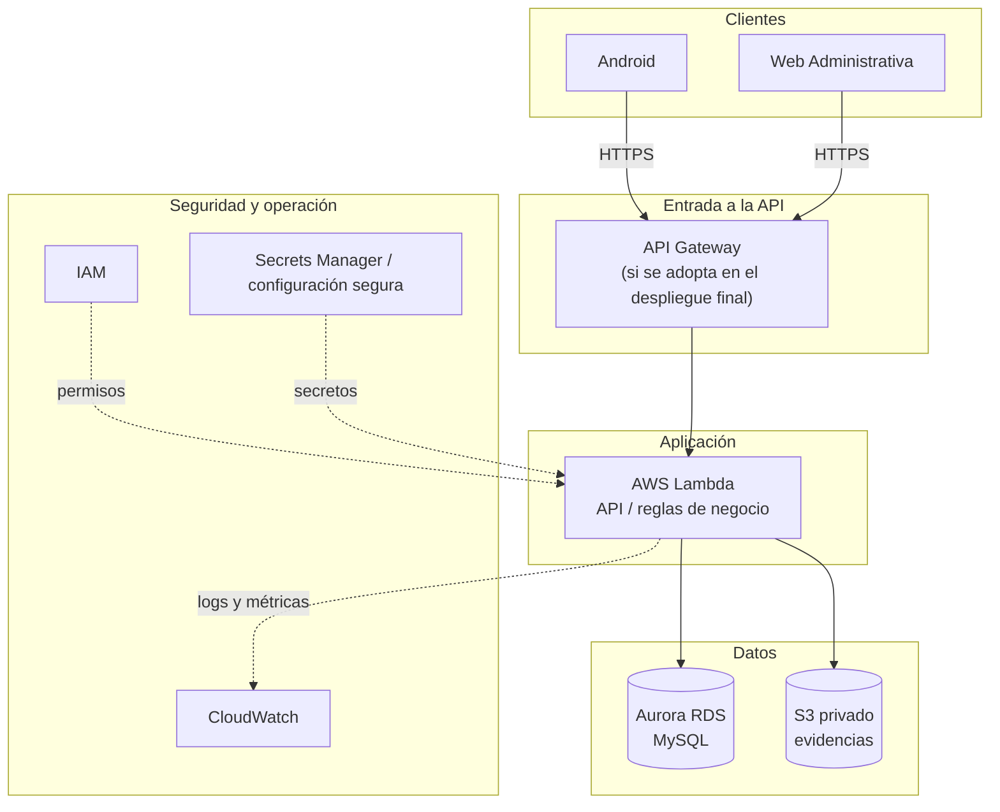

La infraestructura se documenta en:

```text
infra/aws/
```

Componentes previstos inicialmente:

```text
Amazon Aurora RDS
AWS Lambda
Amazon S3
```

Según el diseño final también pueden aparecer:

```text
API Gateway
CloudWatch
IAM
Secrets Manager
VPC
Security Groups
```

## S3

Uso principal:

```text
evidencias fotográficas
```

El bucket no debe ser público.

## Lambda

Ejecutará la lógica del backend según la arquitectura finalmente acordada.

## Aurora

Persistencia relacional:

```text
Aurora MySQL 3 / MySQL 8.0 compatible
```

## Nunca subir

```text
.pem
AWS access keys
DB credentials
Secrets Manager values
tokens
```

---

# 31. Cómo integrar una funcionalidad completa

Ejemplo: crear un reporte.

No pensar únicamente en “hacer la pantalla”.

Una funcionalidad completa puede tocar:

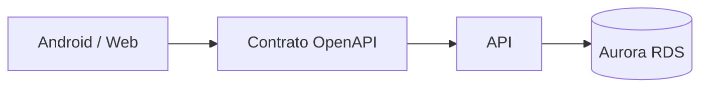

Flujo posible:

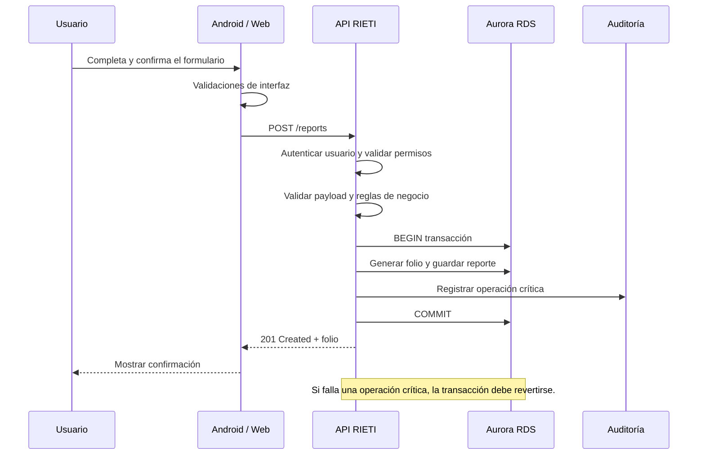

Si cambia el contrato:

```text
contracts/openapi.yaml
```

también debe modificarse.

Si cambia DB:

```text
database/migrations/
```

también debe modificarse.

---

# 32. Checklist antes de subir código

Antes de `git push`:

- [ ] Estoy en mi rama, no en `main`.
- [ ] Ejecuté `git status`.
- [ ] Revisé `git diff`.
- [ ] El proyecto compila.
- [ ] Probé la funcionalidad.
- [ ] No agregué secretos.
- [ ] No agregué `.env`.
- [ ] No agregué `node_modules`.
- [ ] No agregué archivos `build`.
- [ ] El commit tiene un mensaje claro.
- [ ] Actualicé OpenAPI si cambié endpoints.
- [ ] Agregué migration si cambié DB.
- [ ] Agregué pruebas si corresponde.

---

# 33. Errores comunes

## `fatal: not a git repository`

Estás fuera de la carpeta del repo.

```bash
cd ruta/al/rieti
git status
```

## `repository not found`

Puede significar:

- URL incorrecta.
- No tienes acceso.
- No has iniciado sesión correctamente.

Verifica la URL en GitHub.

## `Authentication failed`

GitHub no acepta la contraseña normal de la cuenta como contraseña Git por HTTPS.

En Git para Windows, Git Credential Manager normalmente abre un inicio de sesión en el navegador. Sigue ese flujo.

## `Your branch is behind`

Tu copia está desactualizada.

Si estás en `main` y no tienes cambios:

```bash
git pull origin main
```

## `non-fast-forward`

El remoto tiene commits que tú no tienes.

No hagas force push.

Primero:

```bash
git status
git fetch origin
```

Después revisa qué cambió.

## Android Studio muestra errores inmediatamente después de clonar

Primero espera a:

```text
Gradle Sync
Indexing
```

Si existe:

```text
Sync Project with Gradle Files
```

utilízalo.

## Falta `local.properties`

Es normal que no esté en Git. Android Studio suele generarlo con la ruta del Android SDK de cada computadora.

## `node_modules` no existe después de clonar

Es correcto. Nunca se sube `node_modules`.

Web:

```bash
cd apps/web
npm install
```

API:

```bash
cd services/api
npm install
```

## Un `.gitkeep` desapareció

No importa si la carpeta ahora contiene archivos reales. `.gitkeep` solo servía para conservar carpetas vacías.

---

# 34. Comandos rápidos

## Empezar una tarea nueva

```bash
git checkout main
git pull origin main
git checkout -b feat/mi-tarea
```

## Guardar cambios

```bash
git status
git add .
git commit -m "feat(componente): descripción"
git push -u origin feat/mi-tarea
```

Después crear Pull Request.

## Actualizar main

```bash
git checkout main
git pull origin main
```

## Revisar estado

```bash
git status
```

## Ver ramas

```bash
git branch
```

## Ver historial corto

```bash
git log --oneline -10
```

---

# 35. Regla de oro

Si no sabes qué está pasando en Git:

```bash
git status
```

Lee lo que Git dice antes de ejecutar otro comando.

Si sigues sin entender:

> **No uses `--force`, no borres `.git`, no ejecutes `reset --hard` y no elimines archivos para “arreglar Git”. Pregunta primero.**

---

# Flujo recomendado resumido

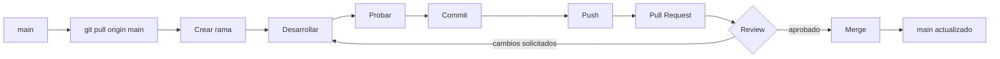

---

# Estado inicial recomendado del equipo

Antes de empezar funcionalidades, comprobar que estén inicializados y subidos:

```text
[ ] apps/android
[ ] apps/web
[ ] services/api
[ ] contracts/openapi.yaml
[ ] database/schema
[ ] .gitignore
[ ] README.md
```

Después de eso, el desarrollo debe realizarse mediante ramas y Pull Requests.

---

**RIETI — Documento interno de desarrollo.**

---

# Anexo A — `.gitignore` recomendado

El archivo `.gitignore` está en la raíz del monorepo y sirve para evitar que Git intente subir archivos locales, compilados, dependencias o secretos.

Contenido recomendado inicial:

```gitignore
# =========================================================
# Sistema operativo
# =========================================================
.DS_Store
Thumbs.db
Desktop.ini

# =========================================================
# IDEs / editores
# =========================================================
.vscode/
.idea/
*.iml

# =========================================================
# Secretos y variables de entorno
# =========================================================
.env
.env.*
!.env.example
*.pem
*.key
*.p12
*.pfx

# =========================================================
# Node.js / React / API
# =========================================================
node_modules/
dist/
coverage/
.npm/
*.log
npm-debug.log*
yarn-debug.log*
yarn-error.log*
pnpm-debug.log*

# =========================================================
# Android / Gradle
# =========================================================
.gradle/
**/build/
local.properties
captures/
.externalNativeBuild/
.cxx/

# =========================================================
# Archivos temporales
# =========================================================
*.tmp
*.temp
*.swp
*.swo

# =========================================================
# AWS / credenciales locales
# =========================================================
.aws/
serverless-state.json
```

> Nota: si en el futuro el equipo necesita compartir alguna configuración específica de `.idea` o VS Code, deberá decidirse explícitamente. No quitar reglas del `.gitignore` al azar.

Después de modificar `.gitignore`:

```bash
git status
```

Si un archivo secreto **ya había sido agregado a Git antes de agregarlo a `.gitignore`**, agregarlo al `.gitignore` no lo elimina automáticamente del seguimiento.

Ejemplo para dejar de seguir un `.env` sin borrarlo de tu computadora:

```bash
git rm --cached services/api/.env
```

Después:

```bash
git commit -m "chore: stop tracking local environment file"
```

Si un secreto real llegó a GitHub, no basta con eliminar el archivo: la credencial debe considerarse comprometida y debe rotarse.

---

# Anexo B — Inicialización del repositorio GitHub (solo responsable inicial)

Esta sección **NO la ejecuta cada integrante**. Se utiliza únicamente si el repositorio todavía no existe en GitHub.

## 1. Crear repositorio en GitHub

En GitHub:

```text
New repository
→ nombre: rieti
→ elegir Private si corresponde
→ Create repository
```

Si ya tienes archivos locales, es preferible crear el repositorio remoto sin generar archivos adicionales que puedan chocar con los locales.

## 2. Desde la raíz local de RIETI

```bash
git init
```

Agregar archivos:

```bash
git add .
```

Primer commit:

```bash
git commit -m "chore: initialize RIETI monorepo"
```

Usar `main` como rama principal:

```bash
git branch -M main
```

Conectar GitHub:

```bash
git remote add origin https://github.com/ORGANIZACION/rieti.git
```

Subir:

```bash
git push -u origin main
```

A partir de ese momento, los demás desarrolladores **no ejecutan `git init`**. Ellos ejecutan:

```bash
git clone https://github.com/ORGANIZACION/rieti.git
```

---

# Anexo C — Clonar usando Android Studio

En la pantalla inicial de Android Studio también existe:

```text
Clone Repository
```

Puede utilizarse, pero para este proyecto se recomienda aprender primero el flujo de terminal porque RIETI es un monorepo y no solamente un proyecto Android.

Si utilizas `Clone Repository`:

1. Copia la URL HTTPS del repositorio GitHub.
2. En Android Studio selecciona `Clone Repository`.
3. Pega la URL.
4. Elige una carpeta local.
5. Espera a que termine el clone.
6. Si Android Studio intenta abrir la raíz completa como proyecto Gradle, ciérrala.
7. Selecciona `Open`.
8. Abre específicamente:

```text
rieti/apps/android
```

Una vez que Android ya fue inicializado, **los compañeros NO deben usar `New Project` para crear otra app RIETI**. Deben clonar el repositorio y abrir `apps/android`.

---

# Anexo D — Configuración recomendada de GitHub para proteger `main`

Cuando el repositorio ya esté funcionando, es recomendable proteger `main` para evitar pushes accidentales.

En GitHub, según la interfaz disponible:

```text
Repository
→ Settings
→ Rules / Branch protection
```

Crear una regla para:

```text
main
```

Recomendaciones:

- exigir Pull Request antes de merge;
- impedir force push;
- impedir eliminación de `main`;
- requerir al menos una revisión si el tamaño del equipo lo permite;
- posteriormente exigir GitHub Actions cuando CI ya esté configurado.

Así, aunque alguien se equivoque e intente:

```bash
git push origin main
```

GitHub puede rechazarlo.

---

# Anexo E — Qué hacer justo después de clonar RIETI

Una vez que Android, Web y API ya estén inicializados en GitHub, una computadora nueva se prepara así.

## 1. Clonar

```bash
git clone https://github.com/ORGANIZACION/rieti.git
cd rieti
```

## 2. Revisar estado

```bash
git status
```

## 3. Instalar dependencias Web

```bash
cd apps/web
npm install
cd ../..
```

## 4. Instalar dependencias API

```bash
cd services/api
npm install
cd ../..
```

## 5. Configurar variables locales

Si existe:

```text
services/api/.env.example
```

crear una copia local llamada:

```text
services/api/.env
```

Completar únicamente con credenciales del entorno de desarrollo proporcionadas de forma segura por el responsable.

Nunca hacer commit del `.env`.

## 6. Android

Abrir Android Studio:

```text
Open → rieti/apps/android
```

Esperar Gradle Sync.

## 7. Verificar antes de trabajar

Desde la raíz:

```bash
git status
git checkout main
git pull origin main
```

Después crear la rama de la tarea.

---

# Anexo F — Docker

RIETI **no utiliza Docker actualmente**.

No existe necesidad de agregar:

```text
docker-compose.yml
Dockerfile
```

solo por convención.

La arquitectura actual está pensada alrededor de servicios administrados/serverless de AWS y desarrollo local nativo.

Si en el futuro Docker resuelve un problema real del equipo, su adopción deberá ser una decisión técnica explícita y documentada.
