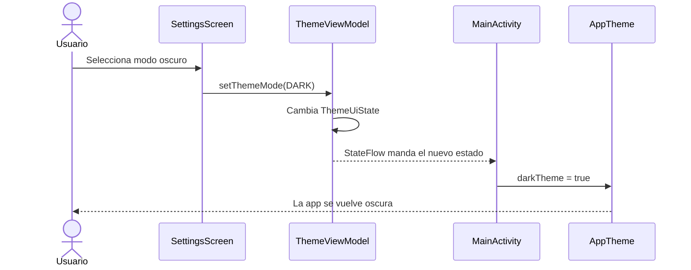
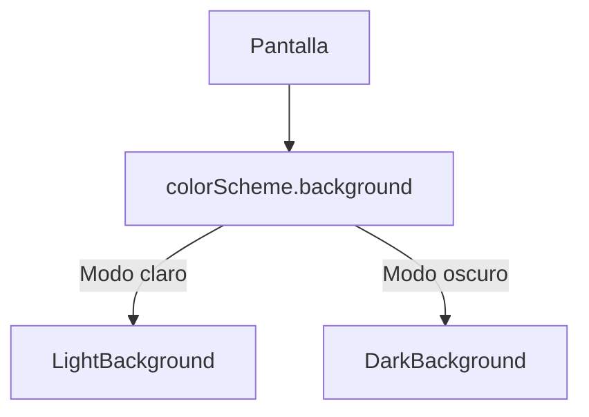
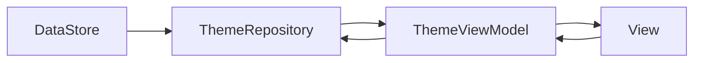

# Guía para trabajar modo claro / oscuro con MVVM en Kotlin

La idea de esta guía es que todos trabajemos las pantallas de la misma forma para que al final no tengamos problemas cuando juntemos todo.

Cada quien va a hacer diferentes pantallas en **Kotlin + Jetpack Compose**, pero todos tenemos que respetar la misma estructura para que el modo claro y el modo oscuro funcionen en toda la app sin tener que hacer dos versiones de cada pantalla.

También vamos a usar **MVVM**, porque es el modelo que estamos viendo en clase.

---

## 1. La idea general

No vamos a hacer esto:

```text
Login claro
Login oscuro

Home claro
Home oscuro

Perfil claro
Perfil oscuro
```

Eso sería duplicar trabajo y además se volvería un problema cuando juntemos todo.

Vamos a hacer **una sola pantalla** y esa pantalla va a tomar sus colores del tema global.

Más o menos así:

```text
                ThemeViewModel
                      |
                      v
                   AppTheme
                      |
          -------------------------
          |           |           |
          v           v           v
       Login        Home        Perfil
```

Entonces, si la app está en claro, todas las pantallas usan la paleta clara.

Si la app está en oscuro, todas usan la paleta oscura.

La pantalla como tal no cambia.

---

# 2. ¿Dónde entra MVVM?

Vamos a respetar la estructura que vimos en clase:

```text
MODEL <----> VIEWMODEL <----> VIEW
```

Aplicado al tema quedaría así:


La idea es sencilla:

### Model

Aquí definimos los posibles modos:

```text
SYSTEM
LIGHT
DARK
```

### ViewModel

Aquí guardamos cuál de esos modos está seleccionado.

Por ejemplo:

```text
DARK
```

### View

La vista observa el estado del ViewModel.

Si recibe:

```text
DARK
```

usa la paleta oscura.

Si recibe:

```text
LIGHT
```

usa la paleta clara.

Si recibe:

```text
SYSTEM
```

usa el tema que tenga configurado el celular.

---

# 3. Estructura de carpetas

Para que todos trabajemos igual, vamos a usar algo parecido a esto:

```text
app/
└── src/main/java/com/example/proyecto/
    │
    ├── model/
    │   └── ThemeMode.kt
    │
    ├── viewmodel/
    │   ├── ThemeUiState.kt
    │   └── ThemeViewModel.kt
    │
    ├── view/
    │   ├── App.kt
    │   │
    │   ├── screens/
    │   │   ├── LoginScreen.kt
    │   │   ├── HomeScreen.kt
    │   │   ├── ProfileScreen.kt
    │   │   └── SettingsScreen.kt
    │   │
    │   └── components/
    │
    ├── ui/
    │   └── theme/
    │       ├── Color.kt
    │       ├── Theme.kt
    │       └── Type.kt
    │
    └── MainActivity.kt
```

No importa si el nombre de alguna carpeta cambia un poco en nuestro proyecto, pero la separación sí debe mantenerse.

---

# 4. Model: `ThemeMode.kt`

Primero necesitamos representar las tres opciones de tema.

```text
model/ThemeMode.kt
```

```kotlin
package com.example.proyecto.model

enum class ThemeMode {
    SYSTEM,
    LIGHT,
    DARK
}
```

Con esto tenemos:

```text
SYSTEM -> sigue el tema del celular
LIGHT  -> fuerza modo claro
DARK   -> fuerza modo oscuro
```

La opción inicial puede ser:

```kotlin
ThemeMode.SYSTEM
```

---

# 5. Estado del tema

Ahora necesitamos un estado que pueda observar la vista.

```text
viewmodel/ThemeUiState.kt
```

```kotlin
package com.example.proyecto.viewmodel

import com.example.proyecto.model.ThemeMode

data class ThemeUiState(
    val themeMode: ThemeMode = ThemeMode.SYSTEM
)
```

Esto es básicamente el estado actual del tema.

Por ahora solo tiene una cosa:

```text
themeMode
```

pero después podría tener más opciones de apariencia si las necesitamos.

---

# 6. ViewModel

Ahora hacemos el ViewModel.

```text
viewmodel/ThemeViewModel.kt
```

```kotlin
package com.example.proyecto.viewmodel

import androidx.lifecycle.ViewModel
import com.example.proyecto.model.ThemeMode
import kotlinx.coroutines.flow.MutableStateFlow
import kotlinx.coroutines.flow.StateFlow
import kotlinx.coroutines.flow.asStateFlow

class ThemeViewModel : ViewModel() {

    private val _uiState = MutableStateFlow(ThemeUiState())

    val uiState: StateFlow<ThemeUiState> =
        _uiState.asStateFlow()

    fun setThemeMode(themeMode: ThemeMode) {
        _uiState.value = _uiState.value.copy(
            themeMode = themeMode
        )
    }
}
```

Aquí estamos usando el mismo concepto que vimos con `StateFlow`.

Tenemos:

```kotlin
private val _uiState
```

que puede modificar el ViewModel.

Y exponemos:

```kotlin
val uiState
```

para que la vista lo pueda observar.

La vista no debería modificar `_uiState` directamente.

---

# 7. Flujo del cambio de tema

Cuando alguien cambie el tema va a pasar esto:



Lo importante es que **SettingsScreen no cambia los colores**.

Solo dice:

```text
quiero DARK
```

y el resto lo resuelve el sistema de tema.

---

# 8. Colores globales

Vamos a tener un solo archivo con la paleta.

```text
ui/theme/Color.kt
```

Ejemplo:

```kotlin
package com.example.proyecto.ui.theme

import androidx.compose.ui.graphics.Color

// Modo claro

val LightPrimary = Color(0xFF415F91)
val LightOnPrimary = Color(0xFFFFFFFF)

val LightSecondary = Color(0xFF565F71)
val LightOnSecondary = Color(0xFFFFFFFF)

val LightBackground = Color(0xFFF9F9FF)
val LightOnBackground = Color(0xFF191C20)

val LightSurface = Color(0xFFFFFFFF)
val LightOnSurface = Color(0xFF191C20)

val LightSurfaceVariant = Color(0xFFE1E2EC)
val LightOnSurfaceVariant = Color(0xFF44474E)

val LightOutline = Color(0xFF74777F)

val LightError = Color(0xFFBA1A1A)
val LightOnError = Color(0xFFFFFFFF)


// Modo oscuro

val DarkPrimary = Color(0xFFA9C7FF)
val DarkOnPrimary = Color(0xFF0A305F)

val DarkSecondary = Color(0xFFBEC6DC)
val DarkOnSecondary = Color(0xFF283141)

val DarkBackground = Color(0xFF111318)
val DarkOnBackground = Color(0xFFE2E2E9)

val DarkSurface = Color(0xFF191C20)
val DarkOnSurface = Color(0xFFE2E2E9)

val DarkSurfaceVariant = Color(0xFF44474E)
val DarkOnSurfaceVariant = Color(0xFFC4C6D0)

val DarkOutline = Color(0xFF8E9099)

val DarkError = Color(0xFFFFB4AB)
val DarkOnError = Color(0xFF690005)
```

Los colores son de ejemplo.

Cuando ya tengamos el diseño final se cambian aquí y listo.

Lo importante es que **las pantallas no tengan sus propios colores sueltos**.

---

# 9. `Theme.kt`

Ahora conectamos esos colores con Material 3.

```text
ui/theme/Theme.kt
```

```kotlin
package com.example.proyecto.ui.theme

import androidx.compose.material3.MaterialTheme
import androidx.compose.material3.darkColorScheme
import androidx.compose.material3.lightColorScheme
import androidx.compose.runtime.Composable

private val LightColorScheme = lightColorScheme(

    primary = LightPrimary,
    onPrimary = LightOnPrimary,

    secondary = LightSecondary,
    onSecondary = LightOnSecondary,

    background = LightBackground,
    onBackground = LightOnBackground,

    surface = LightSurface,
    onSurface = LightOnSurface,

    surfaceVariant = LightSurfaceVariant,
    onSurfaceVariant = LightOnSurfaceVariant,

    outline = LightOutline,

    error = LightError,
    onError = LightOnError
)

private val DarkColorScheme = darkColorScheme(

    primary = DarkPrimary,
    onPrimary = DarkOnPrimary,

    secondary = DarkSecondary,
    onSecondary = DarkOnSecondary,

    background = DarkBackground,
    onBackground = DarkOnBackground,

    surface = DarkSurface,
    onSurface = DarkOnSurface,

    surfaceVariant = DarkSurfaceVariant,
    onSurfaceVariant = DarkOnSurfaceVariant,

    outline = DarkOutline,

    error = DarkError,
    onError = DarkOnError
)

@Composable
fun AppTheme(
    darkTheme: Boolean,
    content: @Composable () -> Unit
) {

    val colorScheme =
        if (darkTheme) {
            DarkColorScheme
        } else {
            LightColorScheme
        }

    MaterialTheme(
        colorScheme = colorScheme,
        typography = Typography,
        content = content
    )
}
```

Aquí básicamente estamos diciendo:

```text
darkTheme = false
        ↓
LightColorScheme
```

o:

```text
darkTheme = true
        ↓
DarkColorScheme
```

---

# 10. Importante: no usar colores dinámicos

Material 3 puede usar colores dinámicos del celular en Android 12 o superior.

Para este proyecto mejor no.

La razón es que queremos que todos veamos la misma app.

Si usamos colores dinámicos, cada celular podría usar colores diferentes dependiendo del fondo o configuración del usuario.

Entonces evitamos:

```kotlin
dynamicDarkColorScheme(...)
dynamicLightColorScheme(...)
```

y usamos nuestra paleta.

---

# 11. MainActivity

Aquí conectamos el ViewModel con el tema.

```kotlin
package com.example.proyecto

import android.os.Bundle
import androidx.activity.ComponentActivity
import androidx.activity.compose.setContent
import androidx.activity.viewModels
import androidx.compose.foundation.isSystemInDarkTheme
import androidx.compose.runtime.collectAsState
import androidx.compose.runtime.getValue
import com.example.proyecto.model.ThemeMode
import com.example.proyecto.ui.theme.AppTheme
import com.example.proyecto.view.App
import com.example.proyecto.viewmodel.ThemeViewModel

class MainActivity : ComponentActivity() {

    private val themeViewModel: ThemeViewModel by viewModels()

    override fun onCreate(savedInstanceState: Bundle?) {
        super.onCreate(savedInstanceState)

        setContent {

            val themeState by
                themeViewModel.uiState.collectAsState()

            val systemDarkTheme =
                isSystemInDarkTheme()

            val useDarkTheme =
                when (themeState.themeMode) {

                    ThemeMode.SYSTEM ->
                        systemDarkTheme

                    ThemeMode.LIGHT ->
                        false

                    ThemeMode.DARK ->
                        true
                }

            AppTheme(
                darkTheme = useDarkTheme
            ) {

                App(
                    themeMode = themeState.themeMode,
                    onThemeModeChange =
                        themeViewModel::setThemeMode
                )
            }
        }
    }
}
```

Aquí ya tenemos todo conectado.

```text
ThemeViewModel
      |
      v
ThemeUiState
      |
      v
MainActivity
      |
      v
AppTheme
      |
      v
Toda la aplicación
```

---

# 12. ¿Por qué `isSystemInDarkTheme()` está aquí?

Porque esto tiene que ver con Compose y con cómo está configurado visualmente el dispositivo.

No necesitamos meterlo al ViewModel.

El ViewModel solo tiene que saber:

```text
SYSTEM
LIGHT
DARK
```

Si es `SYSTEM`, la vista revisa el modo actual del celular usando:

```kotlin
isSystemInDarkTheme()
```

---

# 13. La regla más importante para todos

No usar colores directos dentro de las pantallas.

## MAL

```kotlin
Text(
    text = "Hola",
    color = Color.Black
)
```

```kotlin
Box(
    modifier = Modifier
        .background(Color.White)
)
```

```kotlin
Modifier.border(
    1.dp,
    Color.LightGray
)
```

Tampoco:

```kotlin
Color(0xFFFFFFFF)
Color(0xFF000000)
```

metidos directamente dentro de una pantalla.

Porque en cuanto cambiemos a modo oscuro, eso se queda igual.

---

# 14. Cómo hacerlo bien

Para los fondos:

```kotlin
MaterialTheme.colorScheme.background
```

Para texto sobre el fondo:

```kotlin
MaterialTheme.colorScheme.onBackground
```

Para tarjetas:

```kotlin
MaterialTheme.colorScheme.surface
```

Para texto dentro de tarjetas:

```kotlin
MaterialTheme.colorScheme.onSurface
```

Para elementos secundarios:

```kotlin
MaterialTheme.colorScheme.surfaceVariant
```

Para texto secundario:

```kotlin
MaterialTheme.colorScheme.onSurfaceVariant
```

Para botones principales:

```kotlin
MaterialTheme.colorScheme.primary
```

Para texto o iconos encima de esos botones:

```kotlin
MaterialTheme.colorScheme.onPrimary
```

Para bordes:

```kotlin
MaterialTheme.colorScheme.outline
```

---

# 15. Tabla rápida

| Si necesito... | Uso |
|---|---|
| Fondo de pantalla | `background` |
| Texto sobre fondo | `onBackground` |
| Tarjeta | `surface` |
| Texto dentro de tarjeta | `onSurface` |
| Área secundaria | `surfaceVariant` |
| Texto secundario | `onSurfaceVariant` |
| Botón principal | `primary` |
| Texto/icono del botón | `onPrimary` |
| Botón secundario | `secondary` |
| Texto del botón secundario | `onSecondary` |
| Borde | `outline` |
| Error | `error` |
| Texto sobre error | `onError` |

---

# 16. Ejemplo de una pantalla bien hecha

```kotlin
@Composable
fun ProfileScreen() {

    Column(
        modifier = Modifier
            .fillMaxSize()
            .background(
                MaterialTheme.colorScheme.background
            )
            .padding(24.dp)
    ) {

        Text(
            text = "Mi perfil",
            color =
                MaterialTheme.colorScheme.onBackground,
            style =
                MaterialTheme.typography.headlineMedium
        )

        Spacer(
            modifier = Modifier.height(16.dp)
        )

        Card(
            colors = CardDefaults.cardColors(
                containerColor =
                    MaterialTheme.colorScheme.surface
            )
        ) {

            Column(
                modifier = Modifier.padding(16.dp)
            ) {

                Text(
                    text = "Nombre",
                    color =
                        MaterialTheme.colorScheme.onSurface
                )

                Text(
                    text = "Descripción",
                    color =
                        MaterialTheme.colorScheme.onSurfaceVariant
                )
            }
        }
    }
}
```

Esta pantalla funciona igual en claro y oscuro.

No tiene que preguntar qué tema está activo.

---

# 17. Lo que realmente está pasando

Por ejemplo, la pantalla usa esto:

```kotlin
MaterialTheme.colorScheme.background
```

En modo claro:

```text
background -> LightBackground
```

En modo oscuro:

```text
background -> DarkBackground
```

La pantalla sigue usando exactamente la misma línea de código.



---

# 18. Botones, Cards, TextFields, iconos y bordes

En muchos componentes Material 3 ya toma los colores del tema automáticamente.

Por ejemplo un botón normal:

```kotlin
Button(
    onClick = { }
) {
    Text("Continuar")
}
```

Si necesitamos definirlo manualmente:

```kotlin
Button(
    onClick = { },
    colors = ButtonDefaults.buttonColors(
        containerColor =
            MaterialTheme.colorScheme.primary,
        contentColor =
            MaterialTheme.colorScheme.onPrimary
    )
) {
    Text("Continuar")
}
```

Card:

```kotlin
Card(
    colors = CardDefaults.cardColors(
        containerColor =
            MaterialTheme.colorScheme.surface
    )
) {

    Text(
        text = "Contenido",
        color =
            MaterialTheme.colorScheme.onSurface
    )
}
```

TextField:

```kotlin
OutlinedTextField(
    value = text,
    onValueChange = { text = it },
    label = {
        Text("Correo")
    }
)
```

Icono:

```kotlin
Icon(
    imageVector = Icons.Default.Home,
    contentDescription = "Inicio",
    tint =
        MaterialTheme.colorScheme.onSurface
)
```

Borde:

```kotlin
Modifier.border(
    width = 1.dp,
    color =
        MaterialTheme.colorScheme.outline
)
```

---

# 19. Imágenes

Aquí sí hay que tener cuidado.

Una fotografía normal no necesita cambiar con el modo oscuro.

Pero cosas como logos, iconos PNG o ilustraciones sí pueden dar problemas si ya traen fondo blanco.

Mejor usar cuando se pueda:

```text
SVG
VectorDrawable
PNG transparente
Material Icons
```

---

# 20. Selector del tema

En Configuración podemos poner algo así:

```text
Apariencia

(●) Sistema
( ) Claro
( ) Oscuro
```

Ejemplo:

```kotlin
@Composable
fun ThemeSelector(
    themeMode: ThemeMode,
    onThemeModeChange: (ThemeMode) -> Unit
) {

    Column {

        Text(
            text = "Apariencia",
            style =
                MaterialTheme.typography.titleLarge
        )

        ThemeOption(
            text = "Usar configuración del dispositivo",
            selected =
                themeMode == ThemeMode.SYSTEM,
            onClick = {
                onThemeModeChange(
                    ThemeMode.SYSTEM
                )
            }
        )

        ThemeOption(
            text = "Claro",
            selected =
                themeMode == ThemeMode.LIGHT,
            onClick = {
                onThemeModeChange(
                    ThemeMode.LIGHT
                )
            }
        )

        ThemeOption(
            text = "Oscuro",
            selected =
                themeMode == ThemeMode.DARK,
            onClick = {
                onThemeModeChange(
                    ThemeMode.DARK
                )
            }
        )
    }
}
```

---

# 21. Estado y eventos

Esto también sirve para entender mejor MVVM.

El estado sería:

```kotlin
data class ThemeUiState(
    val themeMode: ThemeMode
)
```

El evento es cuando el usuario toca una opción.

Por ejemplo:

```text
Usuario toca "Oscuro"
```

La vista manda:

```kotlin
themeViewModel.setThemeMode(
    ThemeMode.DARK
)
```

El ViewModel actualiza el estado y Compose lo observa con:

```kotlin
val themeState by
    themeViewModel.uiState.collectAsState()
```

Ese es el flujo.

---

# 22. Qué le toca a cada quien

Para no hacernos conflictos innecesarios en Git, no todos deberíamos estar modificando los archivos del tema.

Una persona puede encargarse de:

```text
ThemeMode.kt
ThemeUiState.kt
ThemeViewModel.kt
Color.kt
Theme.kt
```

Y cada quien trabaja principalmente en:

```text
view/screens/SuPantalla.kt
```

Si alguien necesita un color que no existe, primero lo comentamos y lo agregamos globalmente si hace falta.

No meter colores nuevos directamente dentro de una pantalla porque sí.

---

# 23. Preview claro y oscuro

Cada pantalla debería tener un preview para los dos temas.

Claro:

```kotlin
@Preview(
    name = "Profile - Light",
    showBackground = true
)
@Composable
private fun ProfileLightPreview() {

    AppTheme(
        darkTheme = false
    ) {
        ProfileScreen()
    }
}
```

Oscuro:

```kotlin
@Preview(
    name = "Profile - Dark",
    showBackground = true
)
@Composable
private fun ProfileDarkPreview() {

    AppTheme(
        darkTheme = true
    ) {
        ProfileScreen()
    }
}
```

Así podemos revisar ambas versiones desde Android Studio sin cambiar toda la configuración.

---

# 24. Checklist antes de entregar una pantalla

Antes de decir que una pantalla ya quedó:

- [ ] Se ve bien en modo claro.
- [ ] Se ve bien en modo oscuro.
- [ ] No hay `Color.White` usado como fondo general.
- [ ] No hay `Color.Black` usado como texto general.
- [ ] No hay hexadecimales metidos directamente en la pantalla.
- [ ] Los fondos usan `background` o `surface`.
- [ ] Los textos usan `onBackground` o `onSurface`.
- [ ] Los bordes usan `outline`.
- [ ] Los botones respetan los colores del tema.
- [ ] Los iconos se ven bien en ambos modos.
- [ ] Los PNG no tienen fondos blancos raros.
- [ ] Hay Preview claro.
- [ ] Hay Preview oscuro.
- [ ] La pantalla no detecta por su cuenta si está en oscuro.
- [ ] La pantalla no crea su propio `Theme`.

---

# 25. Qué NO debe hacer el ViewModel

No meter colores en el ViewModel.

Esto no:

```kotlin
class ThemeViewModel : ViewModel() {

    val backgroundColor =
        Color.White
}
```

El ViewModel no necesita saber qué color exacto tiene el fondo.

Solo necesita saber:

```text
SYSTEM
LIGHT
DARK
```

La View es la que convierte eso en la paleta correspondiente.

---

# 26. ¿Qué pasa si cerramos la app?

Con el ejemplo de arriba el tema se mantiene mientras la app siga viva.

Si la cerramos completamente y la volvemos a abrir, regresa a:

```kotlin
ThemeMode.SYSTEM
```

Para una primera versión está bien.

Después podemos guardar la preferencia con **DataStore**.

La idea sería:



Eso ya sería una mejora para que si alguien selecciona oscuro, cierre la app y la abra después, siga en oscuro.

---

# 27. Orden para trabajar

Yo lo haría así:

### Primero

Dejar listos:

```text
ThemeMode.kt
ThemeUiState.kt
ThemeViewModel.kt
Color.kt
Theme.kt
MainActivity.kt
```

y probar:

```text
LIGHT
DARK
SYSTEM
```

### Después

Cada quien hace su pantalla usando:

```kotlin
MaterialTheme.colorScheme
```

### Después

Juntamos todas las pantallas y probamos:

```text
LIGHT -> todas cambian
DARK  -> todas cambian
```

### Al final

Hacemos Configuración con:

```text
Sistema
Claro
Oscuro
```

y si da tiempo agregamos DataStore.

---

# 28. Resumen rápido

No hacemos:

```text
HomeClaro()
HomeOscuro()
```

Hacemos:

```text
HomeScreen()
      |
      v
MaterialTheme.colorScheme
      |
      v
AppTheme
      |
      +--> LightColorScheme
      |
      +--> DarkColorScheme
```

Y con MVVM:

```text
Model
  |
  v
ThemeMode

ViewModel
  |
  v
ThemeUiState
  |
  v
StateFlow

View
  |
  v
MainActivity
  |
  v
AppTheme
  |
  v
Pantallas
```

La regla que hay que recordar es esta:

> No pensemos "este texto debe ser blanco en oscuro".
>
> Pensemos "este texto está encima del fondo, entonces usa `onBackground`".
>
> El tema se encarga de decidir qué color real corresponde.

Con eso todos podemos trabajar pantallas diferentes y cuando juntemos el proyecto no deberíamos tener que estar arreglando una por una para que soporten modo oscuro.
