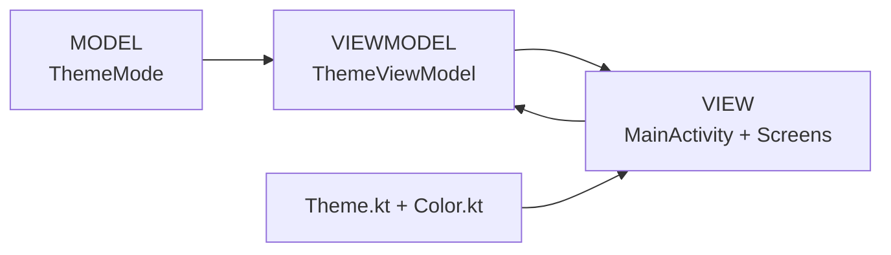
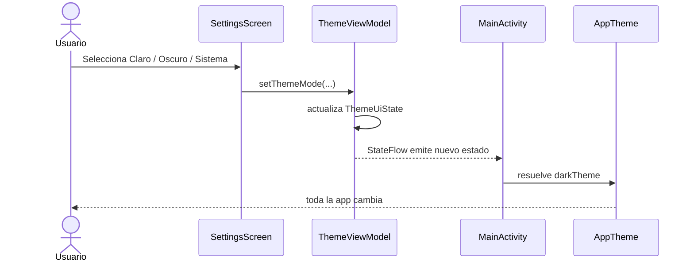

# Guía de equipo: modo claro / oscuro con MVVM en Kotlin (basado en nuestras pantallas)

Hice esta guía para que todos trabajemos igual y no terminemos arreglando colores a lo loco cuando juntemos las pantallas.

Esta vez sí la estoy aterrizando a **las pantallas que ya tenemos**. Tomé como referencia las 4 que compartí:

- **Inicio oscuro**
- **Inicio claro**
- **Login oscuro**
- **Login claro**

Entonces la idea ya no es hablar de colores genéricos, sino de **nuestros colores reales**:  
**negro / blanco**, **rosa-magenta**, **teal/turquesa** y algunos tonos **mint/cian muy claros** para ciertos botones en oscuro.

---

# 1. Qué vamos a hacer y qué NO vamos a hacer

## NO vamos a hacer esto

```text
LoginClaro.kt
LoginOscuro.kt

HomeClaro.kt
HomeOscuro.kt
```

Ni tampoco esto dentro de cada pantalla:

```kotlin
if (darkMode) {
    fondo = Color.Black
} else {
    fondo = Color.White
}
```

Porque eso hace que cada quien resuelva el modo oscuro como quiera y luego todo queda inconsistente.

---

## SÍ vamos a hacer esto

Vamos a tener:

- una sola pantalla;
- un tema global;
- un `ViewModel` que guarde el modo seleccionado;
- y todas las pantallas van a usar `MaterialTheme.colorScheme`.

O sea:

```text
ThemeViewModel
      |
      v
   AppTheme
      |
      +---- LoginScreen
      +---- HomeScreen
      +---- SettingsScreen
      +---- etc
```

Entonces si el modo cambia, no cambiamos la pantalla, cambia el tema.

---

# 2. Cómo se ve nuestra identidad visual ahorita

Con base en las pantallas que compartí, la app trae esta lógica visual:

## En modo claro

- fondo general blanco o casi blanco;
- texto principal negro;
- encabezados / líneas de acento en rosa-magenta;
- botones principales en turquesa / teal;
- detalles decorativos en rosa.

## En modo oscuro

- fondo general negro;
- texto principal blanco;
- el bloque superior sigue usando el degradado rosa;
- los acentos rosa siguen apareciendo;
- los botones principales se van a un tono muy claro tipo mint/cian;
- algunos campos o botones secundarios se mantienen claros para contrastar.

Entonces sí: el modo oscuro **no es solo invertir blanco por negro**.  
Tenemos una identidad bastante marcada y hay que respetarla.

---

# 3. Los colores base que sí vamos a tomar como referencia

No tengo el Figma exacto aquí, así que estos valores son **aproximados a lo que se ve en las pantallas**, pero ya van muchísimo más alineados al diseño real.

## Paleta base de RETRI

### Rosas / magentas
```text
BrandPinkStrong   ≈ #E61B72
BrandPink         ≈ #F03586
BrandPinkSoft     ≈ #F48BB4
BrandPinkVerySoft ≈ #F9C3D8
```

### Teal / turquesa
```text
BrandTealDark     ≈ #2F9F95
BrandTeal         ≈ #36B8AB
BrandTealLight    ≈ #34C7B7
BrandMint         ≈ #C9F7F4
```

### Neutros
```text
PureBlack         ≈ #000000
DarkSurface       ≈ #0A0A0A
White             ≈ #FFFFFF
LightSurface      ≈ #FDFDFD
LightGrayLine     ≈ #E8E8E8
DarkGrayText      ≈ #1A1A1A
```

> Si después nos pasan los hex exactos, solo los cambiamos en `Color.kt` y listo.

---

# 4. Cómo lo aterrizamos a tema claro y oscuro

## Modo claro

La idea de claro es esta:

- `background`: blanco
- `surface`: blanco
- `onBackground`: negro
- `onSurface`: negro
- `primary`: teal
- `onPrimary`: blanco
- `secondary`: rosa o rosa suave dependiendo del componente
- `outline`: rosa suave o gris muy tenue según el caso

## Modo oscuro

La idea de oscuro es esta:

- `background`: negro
- `surface`: negro o casi negro
- `onBackground`: blanco
- `onSurface`: blanco
- `primary`: mint/cian claro para CTA
- `onPrimary`: negro o muy oscuro
- `secondary`: rosa fuerte
- `outline`: rosa o gris oscuro según componente

---

# 5. Dónde entra MVVM

Vamos a usar la estructura que estamos viendo en clase:

```text
MODEL <----> VIEWMODEL <----> VIEW
```

Aplicado al tema sería así:



---

# 6. Responsabilidad de cada capa

## Model
Aquí definimos qué modos existen.

```text
SYSTEM
LIGHT
DARK
```

## ViewModel
Aquí guardamos qué modo está seleccionado y exponemos el estado.

## View
Aquí observamos el estado y dibujamos la UI.

## Theme
Aquí viven los colores reales y cómo se traducen a `MaterialTheme`.

---

# 7. Estructura recomendada

```text
app/
└── src/main/java/com/example/proyecto/
    │
    ├── model/
    │   └── ThemeMode.kt
    │
    ├── viewmodel/
    │   ├── ThemeUiState.kt
    │   └── ThemeViewModel.kt
    │
    ├── view/
    │   ├── App.kt
    │   ├── screens/
    │   │   ├── HomeScreen.kt
    │   │   ├── LoginScreen.kt
    │   │   ├── RegisterScreen.kt
    │   │   └── SettingsScreen.kt
    │   └── components/
    │
    ├── ui/
    │   └── theme/
    │       ├── Color.kt
    │       ├── Theme.kt
    │       └── Type.kt
    │
    └── MainActivity.kt
```

---

# 8. Model: `ThemeMode.kt`

```kotlin
package com.example.proyecto.model

enum class ThemeMode {
    SYSTEM,
    LIGHT,
    DARK
}
```

---

# 9. Estado del tema: `ThemeUiState.kt`

```kotlin
package com.example.proyecto.viewmodel

import com.example.proyecto.model.ThemeMode

data class ThemeUiState(
    val themeMode: ThemeMode = ThemeMode.SYSTEM
)
```

---

# 10. ViewModel: `ThemeViewModel.kt`

```kotlin
package com.example.proyecto.viewmodel

import androidx.lifecycle.ViewModel
import com.example.proyecto.model.ThemeMode
import kotlinx.coroutines.flow.MutableStateFlow
import kotlinx.coroutines.flow.StateFlow
import kotlinx.coroutines.flow.asStateFlow

class ThemeViewModel : ViewModel() {

    private val _uiState = MutableStateFlow(ThemeUiState())

    val uiState: StateFlow<ThemeUiState> =
        _uiState.asStateFlow()

    fun setThemeMode(themeMode: ThemeMode) {
        _uiState.value = _uiState.value.copy(
            themeMode = themeMode
        )
    }
}
```

---

# 11. Flujo del cambio de tema



La pantalla de ajustes no se pone a cambiar colores.  
Solo manda el evento.

---

# 12. `Color.kt` ya aterrizado a nuestro diseño

Aquí sí dejo una propuesta mucho más pegada a las pantallas que compartí.

```kotlin
package com.example.proyecto.ui.theme

import androidx.compose.ui.graphics.Color

// ========= BRAND / ACCENTS =========
val BrandPinkStrong = Color(0xFFE61B72)
val BrandPink = Color(0xFFF03586)
val BrandPinkSoft = Color(0xFFF48BB4)
val BrandPinkVerySoft = Color(0xFFF9C3D8)

val BrandTealDark = Color(0xFF2F9F95)
val BrandTeal = Color(0xFF36B8AB)
val BrandTealLight = Color(0xFF34C7B7)
val BrandMint = Color(0xFFC9F7F4)

val PureBlack = Color(0xFF000000)
val DarkSurfaceBase = Color(0xFF0A0A0A)
val PureWhite = Color(0xFFFFFFFF)
val LightSurfaceBase = Color(0xFFFDFDFD)
val LightGrayLine = Color(0xFFE8E8E8)
val DarkText = Color(0xFF1A1A1A)

// ========= LIGHT =========
val LightPrimary = BrandTeal
val LightOnPrimary = PureWhite

val LightSecondary = BrandPink
val LightOnSecondary = PureWhite

val LightBackground = PureWhite
val LightOnBackground = DarkText

val LightSurface = LightSurfaceBase
val LightOnSurface = DarkText

val LightSurfaceVariant = Color(0xFFFCEAF1)
val LightOnSurfaceVariant = BrandPinkStrong

val LightOutline = BrandPinkSoft

val LightError = Color(0xFFBA1A1A)
val LightOnError = PureWhite

// ========= DARK =========
val DarkPrimary = BrandMint
val DarkOnPrimary = PureBlack

val DarkSecondary = BrandPink
val DarkOnSecondary = PureWhite

val DarkBackground = PureBlack
val DarkOnBackground = PureWhite

val DarkSurface = DarkSurfaceBase
val DarkOnSurface = PureWhite

val DarkSurfaceVariant = Color(0xFF1A1A1A)
val DarkOnSurfaceVariant = BrandPinkVerySoft

val DarkOutline = BrandPink

val DarkError = Color(0xFFFFB4AB)
val DarkOnError = Color(0xFF690005)
```

---

# 13. Nota importante sobre el degradado rosa del encabezado

En las pantallas se ve clarísimo que el bloque superior trae un **degradado rosa**.

Ese degradado no conviene tratarlo como `background` general de toda la app, sino como un recurso visual de secciones específicas.

O sea, para el bloque superior de Inicio o Login podemos hacer algo así:

```kotlin
Brush.verticalGradient(
    colors = listOf(
        BrandPinkStrong,
        BrandPinkSoft
    )
)
```

Entonces:

- el fondo general de pantalla lo controla `background`;
- y el bloque hero / encabezado usa su propio `Brush`.

Eso lo hace mucho más fiel a lo que ya tenemos.

---

# 14. `Theme.kt`

```kotlin
package com.example.proyecto.ui.theme

import androidx.compose.material3.MaterialTheme
import androidx.compose.material3.darkColorScheme
import androidx.compose.material3.lightColorScheme
import androidx.compose.runtime.Composable

private val LightColorScheme = lightColorScheme(
    primary = LightPrimary,
    onPrimary = LightOnPrimary,

    secondary = LightSecondary,
    onSecondary = LightOnSecondary,

    background = LightBackground,
    onBackground = LightOnBackground,

    surface = LightSurface,
    onSurface = LightOnSurface,

    surfaceVariant = LightSurfaceVariant,
    onSurfaceVariant = LightOnSurfaceVariant,

    outline = LightOutline,

    error = LightError,
    onError = LightOnError
)

private val DarkColorScheme = darkColorScheme(
    primary = DarkPrimary,
    onPrimary = DarkOnPrimary,

    secondary = DarkSecondary,
    onSecondary = DarkOnSecondary,

    background = DarkBackground,
    onBackground = DarkOnBackground,

    surface = DarkSurface,
    onSurface = DarkOnSurface,

    surfaceVariant = DarkSurfaceVariant,
    onSurfaceVariant = DarkOnSurfaceVariant,

    outline = DarkOutline,

    error = DarkError,
    onError = DarkOnError
)

@Composable
fun AppTheme(
    darkTheme: Boolean,
    content: @Composable () -> Unit
) {
    val colorScheme =
        if (darkTheme) DarkColorScheme
        else LightColorScheme

    MaterialTheme(
        colorScheme = colorScheme,
        typography = Typography,
        content = content
    )
}
```

---

# 15. MainActivity

```kotlin
package com.example.proyecto

import android.os.Bundle
import androidx.activity.ComponentActivity
import androidx.activity.compose.setContent
import androidx.activity.viewModels
import androidx.compose.foundation.isSystemInDarkTheme
import androidx.compose.runtime.collectAsState
import androidx.compose.runtime.getValue
import com.example.proyecto.model.ThemeMode
import com.example.proyecto.ui.theme.AppTheme
import com.example.proyecto.view.App
import com.example.proyecto.viewmodel.ThemeViewModel

class MainActivity : ComponentActivity() {

    private val themeViewModel: ThemeViewModel by viewModels()

    override fun onCreate(savedInstanceState: Bundle?) {
        super.onCreate(savedInstanceState)

        setContent {
            val themeState by
                themeViewModel.uiState.collectAsState()

            val useDarkTheme =
                when (themeState.themeMode) {
                    ThemeMode.SYSTEM -> isSystemInDarkTheme()
                    ThemeMode.LIGHT -> false
                    ThemeMode.DARK -> true
                }

            AppTheme(
                darkTheme = useDarkTheme
            ) {
                App(
                    themeMode = themeState.themeMode,
                    onThemeModeChange = themeViewModel::setThemeMode
                )
            }
        }
    }
}
```

---

# 16. Regla más importante para todos

No meter colores duros en las pantallas.

## MAL

```kotlin
.background(Color.White)
```

```kotlin
.background(Color.Black)
```

```kotlin
color = Color.Magenta
```

```kotlin
border = BorderStroke(1.dp, Color.LightGray)
```

## BIEN

```kotlin
.background(MaterialTheme.colorScheme.background)
```

```kotlin
color = MaterialTheme.colorScheme.onBackground
```

```kotlin
containerColor = MaterialTheme.colorScheme.primary
```

```kotlin
color = MaterialTheme.colorScheme.outline
```

---

# 17. Tabla rápida para el equipo

| Si necesito... | Usar |
|---|---|
| fondo de pantalla | `background` |
| texto sobre fondo | `onBackground` |
| tarjeta o contenedor | `surface` |
| texto dentro de contenedor | `onSurface` |
| botón principal | `primary` |
| texto del botón principal | `onPrimary` |
| acento secundario | `secondary` |
| texto/acento secundario | `onSecondary` |
| variante o bloque secundario | `surfaceVariant` |
| texto secundario | `onSurfaceVariant` |
| líneas o bordes | `outline` |

---

# 18. Cómo se traduce esto a nuestras pantallas

## Inicio claro
- fondo general blanco;
- textos negros;
- botones teal;
- acentos rosa;
- bloque superior con degradado rosa.

## Inicio oscuro
- fondo general negro;
- textos blancos;
- CTA principal en mint/cian claro;
- botón secundario claro;
- acentos rosa;
- bloque superior con el mismo degradado rosa.

## Login claro
- fondo blanco;
- labels en negro;
- líneas y enlaces rosa;
- inputs con acento teal;
- botón principal teal.

## Login oscuro
- fondo negro;
- labels en blanco;
- inputs claros;
- botón principal mint/cian claro;
- acentos rosa;
- enlaces rosa.

---

# 19. Ejemplo de pantalla bien hecha

```kotlin
@Composable
fun LoginScreen() {
    Column(
        modifier = Modifier
            .fillMaxSize()
            .background(
                MaterialTheme.colorScheme.background
            )
            .padding(16.dp)
    ) {

        Box(
            modifier = Modifier
                .fillMaxWidth()
                .height(160.dp)
                .background(
                    brush = Brush.verticalGradient(
                        colors = listOf(
                            BrandPinkStrong,
                            BrandPinkSoft
                        )
                    )
                )
        )

        Spacer(modifier = Modifier.height(16.dp))

        Text(
            text = "Correo",
            color = MaterialTheme.colorScheme.onBackground
        )

        OutlinedTextField(
            value = "",
            onValueChange = {},
            modifier = Modifier.fillMaxWidth()
        )

        Spacer(modifier = Modifier.height(12.dp))

        Button(
            onClick = {},
            modifier = Modifier.fillMaxWidth(),
            colors = ButtonDefaults.buttonColors(
                containerColor = MaterialTheme.colorScheme.primary,
                contentColor = MaterialTheme.colorScheme.onPrimary
            )
        ) {
            Text("Iniciar Sesión")
        }
    }
}
```

---

# 20. Ojo con el degradado y decoraciones circulares rosas

En las pantallas también se ven formas tipo arcos / círculos rosas.

Eso no tiene por qué vivir dentro del `colorScheme` como si fuera color funcional.

Eso puede estar mejor como:

- un componente decorativo;
- un asset;
- o un canvas / dibujo propio.

O sea:

- `background`, `primary`, `surface`, etc. = colores funcionales;
- arcos rosas decorativos = recurso visual del diseño.

No mezclar ambas cosas.

---

# 21. Selector de tema

En ajustes podemos usar esto:

```text
Apariencia

(●) Sistema
( ) Claro
( ) Oscuro
```

Ejemplo:

```kotlin
@Composable
fun ThemeSelector(
    themeMode: ThemeMode,
    onThemeModeChange: (ThemeMode) -> Unit
) {
    Column {
        ThemeOption(
            text = "Sistema",
            selected = themeMode == ThemeMode.SYSTEM,
            onClick = { onThemeModeChange(ThemeMode.SYSTEM) }
        )

        ThemeOption(
            text = "Claro",
            selected = themeMode == ThemeMode.LIGHT,
            onClick = { onThemeModeChange(ThemeMode.LIGHT) }
        )

        ThemeOption(
            text = "Oscuro",
            selected = themeMode == ThemeMode.DARK,
            onClick = { onThemeModeChange(ThemeMode.DARK) }
        )
    }
}
```

---

# 22. Preview claro y oscuro

Cada pantalla debería traer ambos previews.

```kotlin
@Preview(name = "Login Light", showBackground = true)
@Composable
private fun LoginLightPreview() {
    AppTheme(darkTheme = false) {
        LoginScreen()
    }
}
```

```kotlin
@Preview(name = "Login Dark", showBackground = true)
@Composable
private fun LoginDarkPreview() {
    AppTheme(darkTheme = true) {
        LoginScreen()
    }
}
```

---

# 23. Qué le toca a cada quien

Para evitar conflictos:

## Una persona se encarga de
- `Color.kt`
- `Theme.kt`
- `ThemeMode.kt`
- `ThemeUiState.kt`
- `ThemeViewModel.kt`

## Cada quien se encarga de
- su pantalla;
- sus componentes;
- respetar `MaterialTheme.colorScheme`.

---

# 24. Qué NO quiero que pase

No quiero que cuando juntemos todo pase esto:

```text
Pantalla 1 -> usa teal
Pantalla 2 -> usa otro teal distinto
Pantalla 3 -> usa rosa neón diferente
Pantalla 4 -> usa gris genérico que nada que ver
```

Si ocupamos otro tono, se habla y se agrega al sistema global.

---

# 25. Checklist antes de entregar una pantalla

- [ ] Se ve bien en claro.
- [ ] Se ve bien en oscuro.
- [ ] Respeta negro/blanco según el modo.
- [ ] Mantiene los acentos rosa donde toca.
- [ ] Usa teal/mint correcto para acciones.
- [ ] No trae colores metidos directo en la pantalla.
- [ ] El bloque superior usa el degradado rosa correcto si aplica.
- [ ] Los textos tienen buen contraste.
- [ ] Los botones se distinguen bien.
- [ ] Tiene preview claro.
- [ ] Tiene preview oscuro.

---

# 26. Mejora futura: guardar preferencia con DataStore

Con lo de arriba el tema ya funciona.

Después, si queremos que el usuario cierre la app y se guarde su preferencia, ya metemos `DataStore`.

Pero primero hay que dejar bien esto:

```text
1. Tema global
2. ViewModel del tema
3. Pantallas usando colorScheme
4. Claro y oscuro consistentes
```

---

# 27. Resumen final

La lógica correcta es esta:

```text
No hacemos:
LoginClaro()
LoginOscuro()

Sí hacemos:
LoginScreen()
      |
      v
MaterialTheme.colorScheme
      |
      v
AppTheme
      |
      +--> LightColorScheme
      |
      +--> DarkColorScheme
```

Y en cuanto a diseño, los colores base que vamos a respetar son:

- **fondo blanco / negro**
- **acento rosa-magenta**
- **CTA teal / turquesa**
- **CTA claro mint/cian en oscuro**
- **degradado rosa en encabezados**
- **decoraciones rosas como recurso visual**

La regla clave es esta:

> La pantalla no decide el color final.  
> La pantalla solo decide el propósito del color.

O sea, en vez de pensar:

```text
"aquí quiero blanco"
```

pensamos:

```text
"aquí quiero onBackground"
```

y el tema decide si eso termina siendo blanco o negro según el modo.

Con eso todos podemos trabajar por separado y luego integrar sin andar corrigiendo el modo oscuro pantalla por pantalla.
