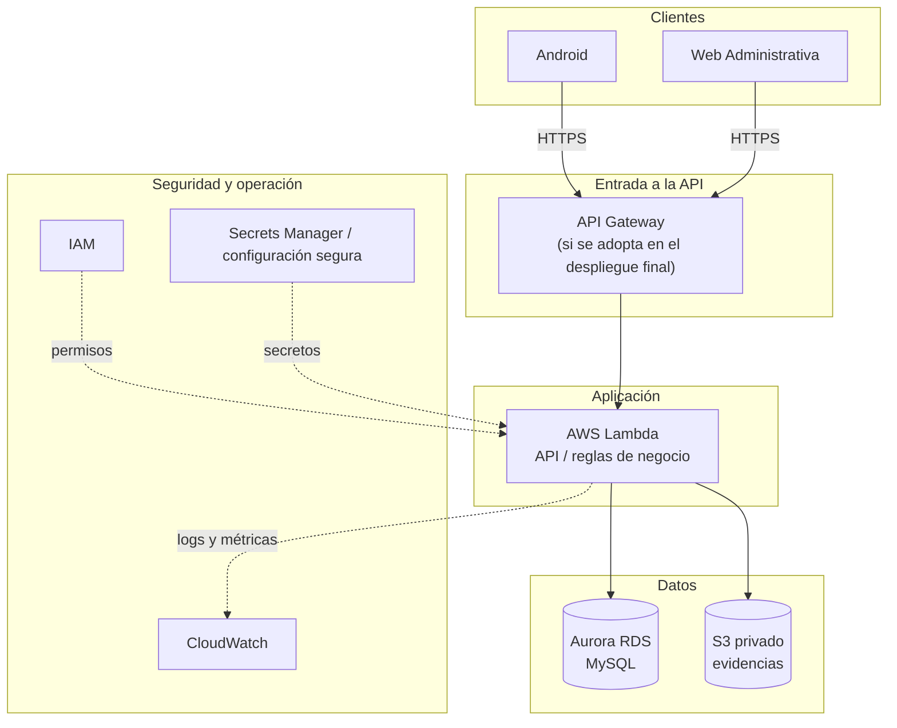
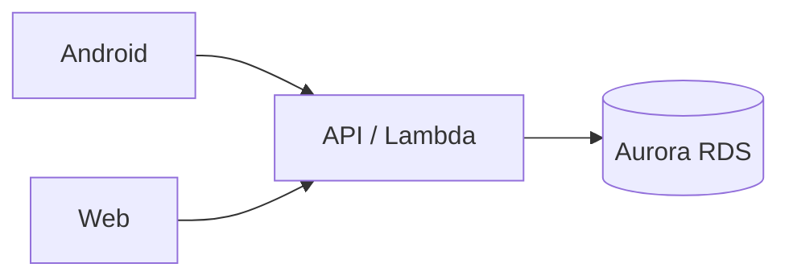
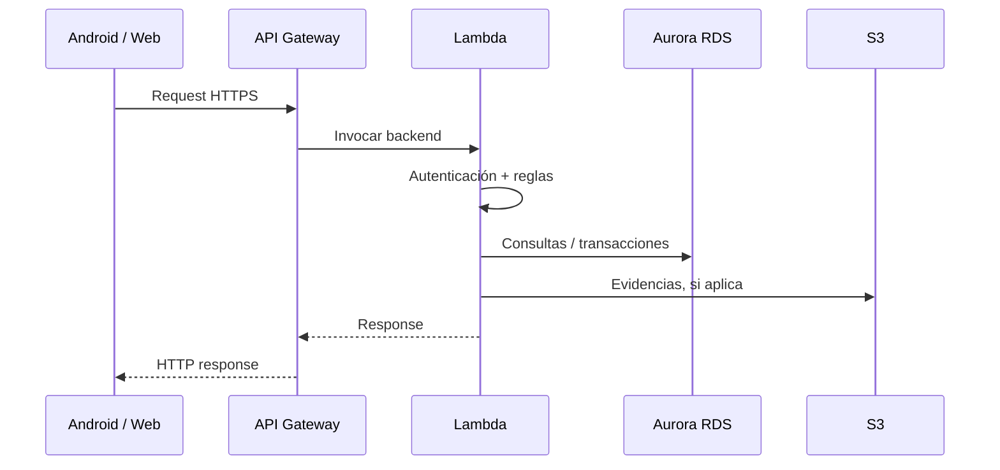
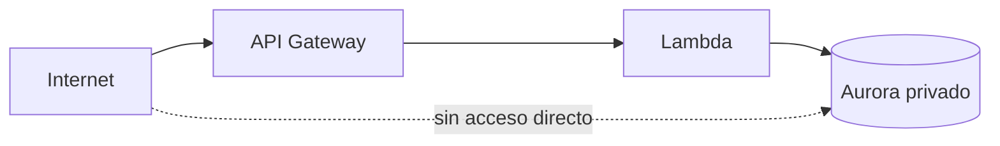

# Infraestructura AWS — RIETI

Este documento describe la infraestructura prevista para RIETI dentro de AWS.

## Arquitectura general



## Componentes previstos

```text
Amazon Aurora RDS
AWS Lambda
Amazon S3
```

Según el diseño final también pueden utilizarse:

```text
API Gateway
CloudWatch
IAM
Secrets Manager
VPC
Security Groups
```

## Amazon Aurora RDS

La persistencia relacional del sistema utilizará:

```text
Aurora MySQL 3 / compatible con MySQL 8.0
```

La Web y la aplicación Android nunca deben conectarse directamente a Aurora.



Las credenciales de conexión deben mantenerse fuera del repositorio.

## Amazon S3

Uso principal:

```text
Evidencias fotográficas
```

El bucket debe ser privado.

Las fotografías no deben almacenarse como archivos públicos ni exponerse directamente desde dashboards o mapas de calor.

La base de datos únicamente debe conservar los metadatos y la referencia segura al objeto almacenado en S3.

## AWS Lambda

Lambda ejecutará la lógica del backend según la arquitectura final acordada.

Responsabilidades principales:

- autenticación;
- autorización;
- validación de reglas de negocio;
- acceso a Aurora;
- manejo de evidencias en S3;
- auditoría;
- notificaciones;
- generación de folios;
- actualización de estados y semáforo.

## API Gateway

Si se adopta en el despliegue final, será la entrada HTTPS de la API.



## IAM

Los permisos deben seguir el principio de mínimo privilegio.

- Lambda solo debe poder acceder a los recursos que realmente necesita.
- El acceso a S3 debe limitarse al bucket de RIETI.
- Aurora no debe quedar expuesto públicamente sin necesidad.
- Los desarrolladores no deben compartir credenciales AWS.

## Secrets Manager / configuración segura

Nunca almacenar secretos directamente en código.

Ejemplos de secretos:

```text
DB_HOST
DB_USER
DB_PASSWORD
JWT_SECRET
AWS credentials
tokens
```

No deben incluirse en GitHub.

## CloudWatch

Puede utilizarse para:

- logs de Lambda;
- errores de ejecución;
- métricas;
- monitoreo;
- diagnóstico.

Los logs no deben contener:

```text
contraseñas
JWT completos
tokens
datos personales sensibles
información privada de menores
```

## VPC y Security Groups

Si Aurora se despliega dentro de una VPC, el acceso debe restringirse únicamente a los componentes autorizados.



## Archivos y secretos que nunca deben subirse al repositorio

```text
.pem
.env
AWS access keys
AWS secret keys
DB credentials
Secrets Manager values
tokens
private keys
```

## Ubicación en el repositorio

Este archivo debe ubicarse en:

```text
infra/aws/README.md
```
